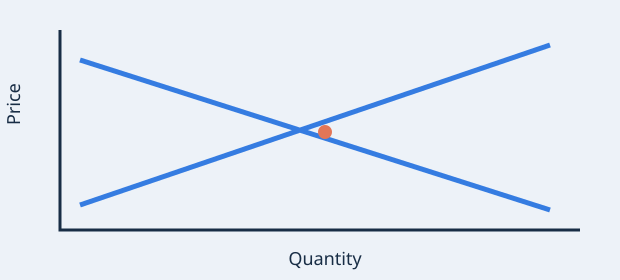

# Native headings, real block previews

## Image layout

This paragraph is above the image. Headings keep the original extension's font sizes and hidden Markdown markers.

**Text after the image.** This line must remain below the image, with no overlap.

## Market structure comparison

The first column wraps independently. Scroll sideways inside the table to see every market.

| Characteristic | Perfect competition | Monopolistic competition | Oligopoly | Monopoly |
|---|---|---|---|---|
| Example of firms in this market | Farm produce | Restaurants | Mobile networks | Local water utility |
| Number of firms | Many | Many | Few | One |
| What is the shape of a firm's demand curve? | Horizontal | Downward sloping | Depends on competitors' responses | Downward sloping |
| Products are differentiated, identical, both, or unique | Identical | Differentiated | Either identical or differentiated | Unique |
| Are firms price-takers or price-makers? | Price-takers | Some pricing power | Strategic pricing | Price-maker |
| What is the relationship between price and marginal revenue? | Price equals marginal revenue | Price exceeds marginal revenue | Depends on competition | Price exceeds marginal revenue |
| Do firms produce a socially efficient level of output? | Under ideal assumptions | Generally not | Generally not | Generally not |

**Text after the table.** This line must remain outside the table and readable.

### Edit normally

Use the block's Edit source button to change the Markdown, then move the cursor outside the block to see it rendered again.
